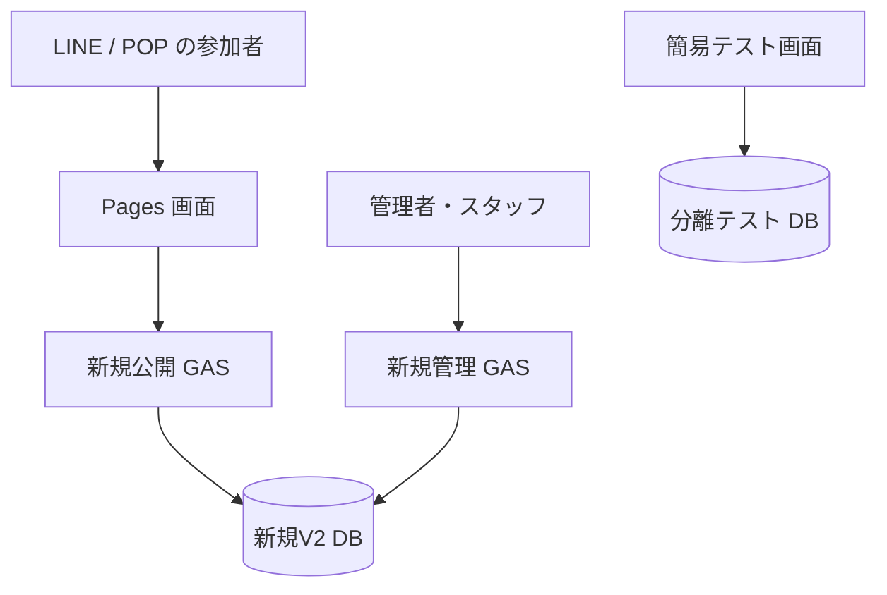

# 構成・処理設計

## 想定構成

- 新規V2スプレッドシート：開催、参加者、開催別カード、日別抽選履歴、スタッフ確認、監査、処理ログ。簡易テストは別ブック。
- 新規公開GAS：参加登録・状態・抽選の公開API。公開側に管理メニューや認証情報を置かない。
- 新規管理スプレッドシート＋紐付けGAS：開催設定、停止・再開、スタッフ確認、簡易テスト、後続の集計。
- 新規検証用GitHub Pages：既存の固定URL、ファイル名と `?source=line|pop` は維持する想定。検証ページを分離し、承認まで本番への反映はしない。

## 重要な書込境界

抽選の意図上の確定点は開催ID・参加者ID・JST日付に対する日別履歴です。同じ要求IDは再送で同じ結果に解決し、別要求でも同日の重複付与を拒否します。停止・設定更新・スタッフ確認はそれぞれ権限と状態を毎回サーバーで再検証します。

V2運用DBの書込責務を新規公開GASに一本化しました。管理GASは画面・権限入口と読み取りを担当し、開催設定・停止/再開・確認完了・集計更新はHMAC署名付きRPCで公開GASへ依頼します。公開GASは同じ `ScriptLock` 内で最新開催状態を読み直し、書込を確定します。簡易テストと詳細検証は別DBに閉じ、管理GAS側の独立したロックを使います。履歴+カード、開催設定+監査、確認完了+ログはSheets API `batchUpdate` で一括更新します。

これにより異なるGASのロックを共有する設計を避けます。R05は設計上の単一書込経路とatomic batch候補まで実装済みですが、署名RPC、ScriptLock競合、Advanced Sheets Service、部分失敗、応答消失の実行検証は未実施です。R05/T10/T20/T23/T24を隔離環境で合格するまで本番導入しません。

## 設定と自動切替

JSTの暦日文字列を使い、開催区間は開始日と終了日を含むものとして扱います。保存時に期間重複を拒否し、対象のない日・開催前・開催終了・停止を別状態にします。複数該当は安全停止です。停止中の開催も予約期間として重複判定に含めます。

## 画面との契約

画面は既存の同一ブラウザ保存キー `daily-dice.identity.v1`、参加カード選択、サイコロ演出、達成演出、コード表示、状態再取得を引き継ぎます。APIは開催情報・当日可否・カード・過去カード一覧を返します。開催なし、旧開催カードの参照、0時境界後の旧画面拒否を互換試験に含めます。

本候補の公開UIは第一弾の提供HTML/CSS/JSを基にしています。原典R07で採用版が確定していない「タップ停止と固定待ち」の差は解消済みと扱っていません。
